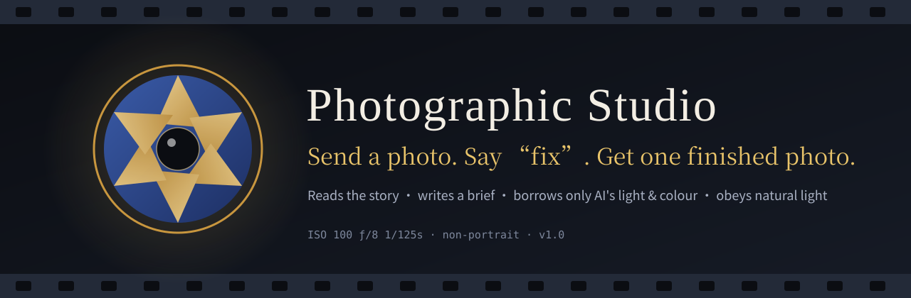
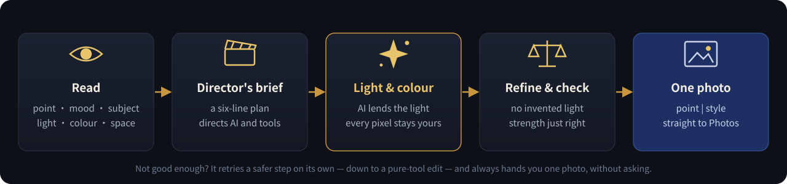

<p align="center">
  
</p>

<p align="center">
  <b>English</b> ·
  <a href="README.zh-CN.md">简体中文</a> ·
  <a href="README.zh-TW.md">繁體中文</a>
</p>

<p align="center">
  
  
  
  
  
</p>

<p align="center">
  <b>Send a photo. Say one word: “fix” (or 「修」).</b><br>
  Like a seasoned retoucher, it first reads what your photo is about — then hands you back one finished image<br>
  that <b>clearly looks better, is still the moment you captured, has light that makes sense, and shows no trace of AI</b>.
</p>

---

## 🎞️ Before &amp; after

> Left: original. Right: finished. All photos were taken by the author; every result here was picked and approved by the author.

<table>
  <tr>
    <td width="50%"><br><sub><b>Tower and reflection at night</b> · the night sky stays black; the tower, bridge and reflections glow clearer</sub></td>
    <td width="50%"><br><sub><b>Canal and clouds</b> · the sky gains colour and volume; trees emerge from the blacks</sub></td>
  </tr>
  <tr>
    <td><br><sub><b>Inlaid bronze ox lamp</b> · bronze, green patina and red inlay come apart; the black wall stays clean</sub></td>
    <td><br><sub><b>Cobalt-and-gold vase</b> · deeper cobalt, brighter gold — and not a lumen added to the dark showcase</sub></td>
  </tr>
  <tr>
    <td><br><sub><b>Clock tower framed by steel</b> · warm sunset against cool steel</sub></td>
    <td><br><sub><b>Willows over a lake</b> · restrained clarity, the quiet of a clear day</sub></td>
  </tr>
</table>

---

## 🎬 How it edits a photo

<p align="center">
  
</p>

**1 · Read the photo**　First it answers *what is this photo about?* — story, mood, subject, style. Then: where the light comes from, how the colours work, how space is layered.

**2 · Write a director's brief**　Six lines of post-production intent, for example:

```text
Story | style : a dark showcase; cobalt glaze and gold catch the exhibit light | low-key museum still life
Subject       : the cobalt vase — amplify the lit volume and the gold relief; keep the background dark
Tone          : keep the blacks, ease the highlights, open the subject's midtones, more local contrast
Colour        : cobalt and warm gold lead; richer glaze and gilding; calm the plinth's colour cast
Do not touch  : shape, patterns, finial, label, the real reflections in the glass
Composition   : keep — the line drawing, the vase and the reflection tell the exhibition together
```

**3 · Borrow only AI's light &amp; colour**　The host's image model makes a version, but **only its light and colour are taken**. Every pixel of the result still comes from your original — the text, the people, the textures are the ones you actually captured.

**4 · Refine and check**　Deterministic grading tools finish the brief, then the image has to pass two gates:

- **Physics** — brightening only lands where light already falls; no invented halos around an exhibit, no real highlights or glaze sheen wiped away; tonal order, sky gradients and reflections all have to make sense.
- **Strength** — visibly better, never overdone; museum pieces are judged on the subject itself.

Not good enough? It quietly retries a safer step on its own until a result passes — **it never stops to ask you**.

**5 · One photo**　You get exactly one image, with a single line: `story | style`.

---

## 🧭 Four things it never compromises on

| | |
|:--:|---|
| 🔆 | **Expression first** — an edit nobody can see counts as a failure. |
| 📷 | **Still your moment** — same scene, same time, same viewpoint. |
| 🕯️ | **Light that makes sense** — amplify the light already in the photo; never paint light that couldn't exist. |
| 🍃 | **No AI look** — nothing waxy or plastic, no fake detail, no fake HDR. |

---

## 🚀 Getting started

**Install as an Agent Skill**: install the whole [`photographic-studio/`](photographic-studio) folder into any host that supports `SKILL.md`, then:

```text
(send a photo) fix
```

**Hosts without skill install**: zip the folder, attach it, and say:

```text
Process this photo with the attached Photographic Studio
```

### What you can say

| You say | It does |
|---|---|
| `fix` · `修` | read → brief → edit → check → one finished photo |
| `fine-tune` · `精修` | explores several directions and keeps the best (slower) |
| `too warm` · `a bit clearer` | rewrites the brief, redoes it, and remembers your taste |
| `show receipt` · `看回执` | brief, prompt, parameters, check results |
| `show flag log` · `看标记表` | a running log of flags across photos |

### Capability tiers

It looks at what the host can do first, then decides how to work:

| Tier | Host can… | How the photo is made |
|:--:|---|---|
| **T1** | edit images with a model **and** run Python | original pixels + AI light &amp; colour → refine |
| **T2** | run Python only | deterministic grading |
| **T3** | edit images with a model only | the model's edit, honestly labelled |
| **T4** | neither | a reading of the photo and editing advice |

---

## ⚙️ Engine (v2.0.0, prototype)

The same pipeline as code, without ChatGPT: model APIs for the brief and G, the deterministic tools for everything else, an evaluation harness and an HTTP service skeleton for the future app. API keys are left empty on purpose — see [`engine/README.md`](engine/README.md).

## 🗂️ Repository layout

```text
photographic-studio/          ← the skill itself (install this folder)
├── SKILL.md                  ← entry point and instructions
├── references/               ← principles, reading & prescriptions, genres, brief, physics, strength, delivery…
│   └── genres/               ← architecture · street · landscape · night · interior · still life & museum
├── optional/                 ← tools (numpy · Pillow · OpenCV)
│   ├── finish.py             ← one-step edit with an automatic retry ladder
│   ├── look_transfer.py      ← original pixels + AI light & colour
│   ├── grade.py              ← grading by the director's brief
│   ├── settle.py             ← strength calibration in one call
│   ├── physics_check.py      ← natural-light physics check
│   └── intensity_check.py    ← strength check
├── assets/taste/             ← taste references: before/after pairs approved by the author
├── CHANGELOG.md
└── SHA256SUMS.txt
docs/images/                  ← illustrations for this page
README.md · README.zh-CN.md · README.zh-TW.md
LICENSE                       ← AGPL-3.0
```

> The skill's own instructions and references are written in Chinese; any capable agent can follow them.

---

## 📜 License

The skill — instructions, references and tools — is licensed under the [GNU Affero General Public License v3.0](LICENSE).
The example photographs in `photographic-studio/assets/taste/` are © the author and are **not** covered by this license; please do not reuse them without permission.

---

<p align="center">
  <sub>Photographic Studio v1.0.8 · made for non-portrait photography · built together with Claude · code &amp; docs AGPL-3.0 · photos © the author</sub>
</p>
