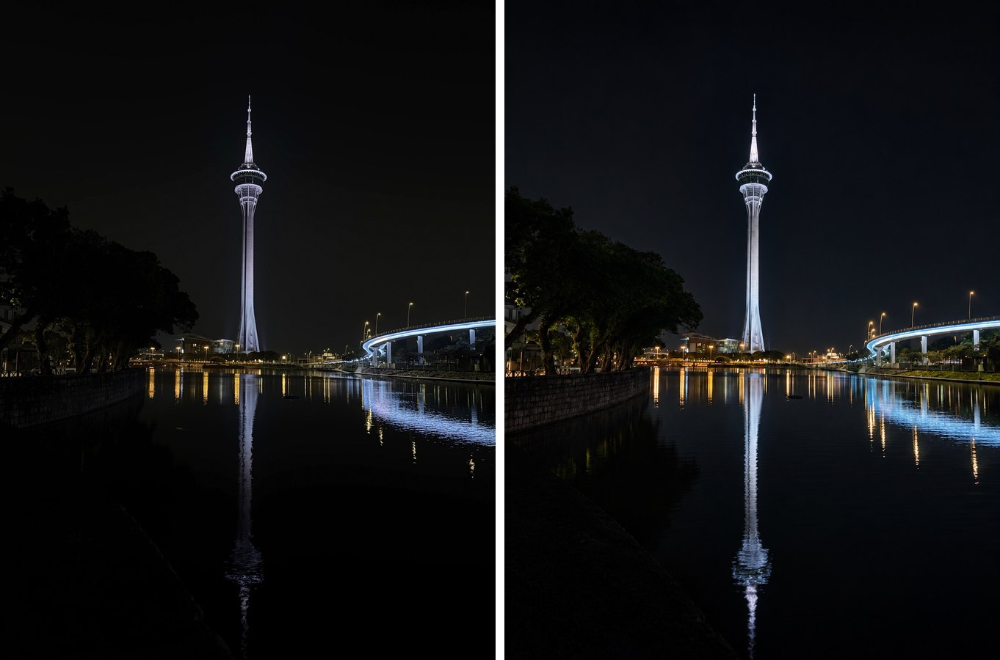
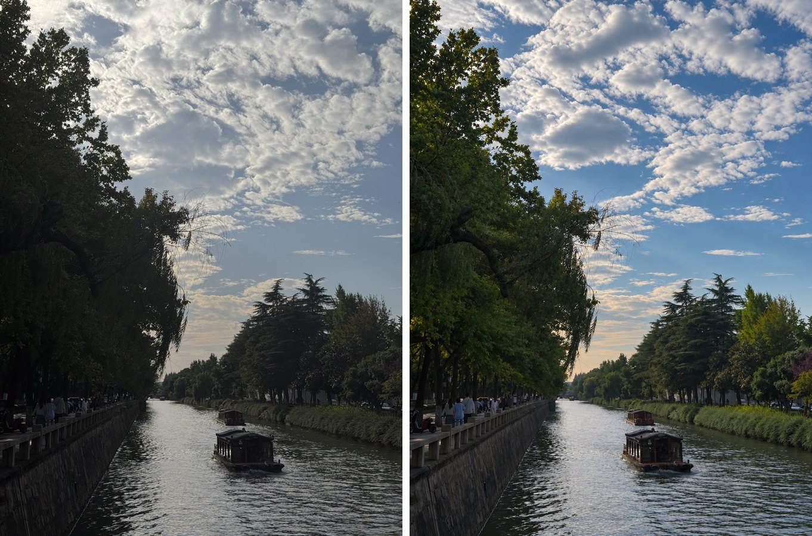
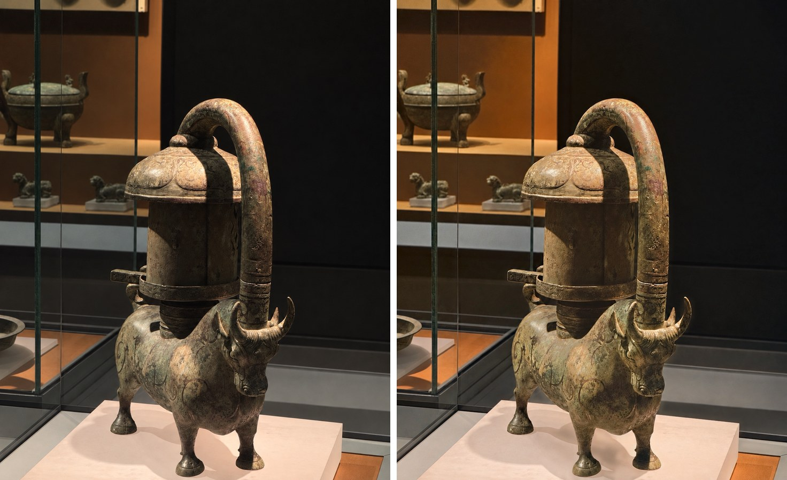
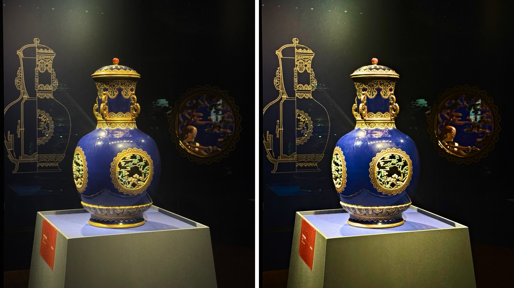
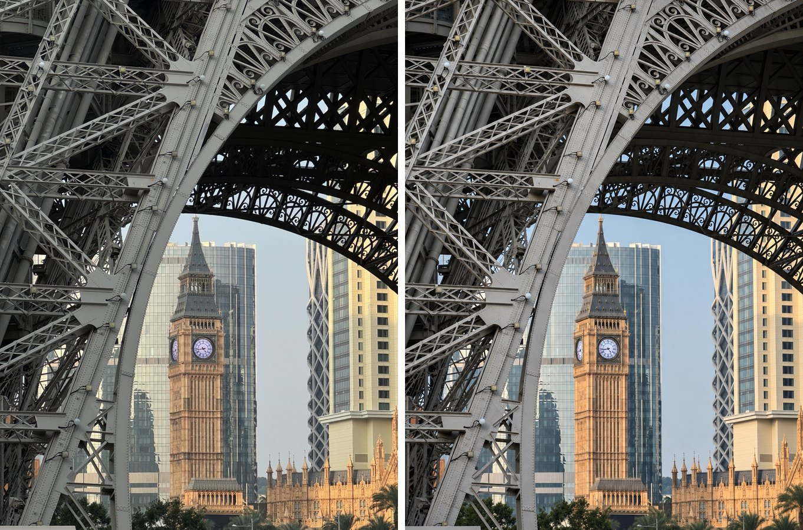
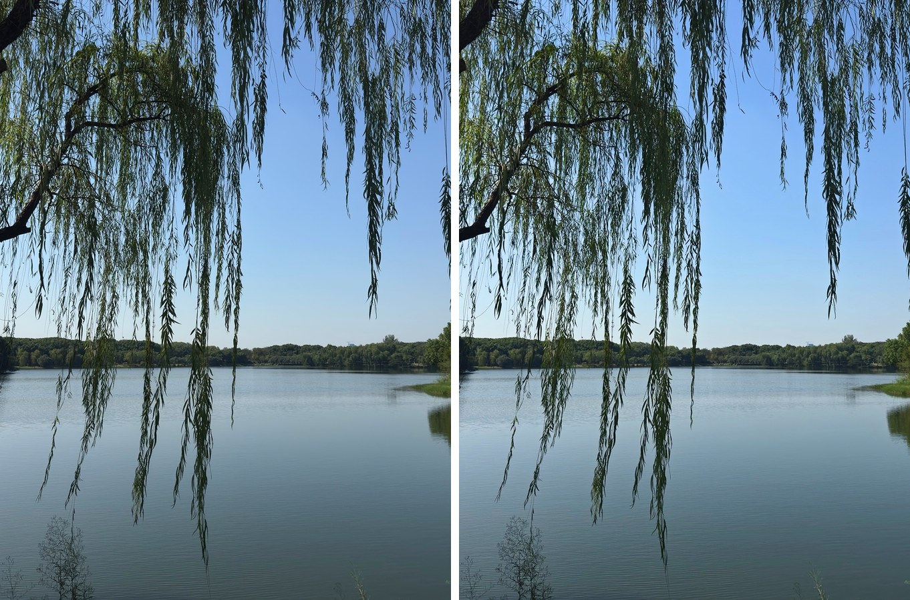
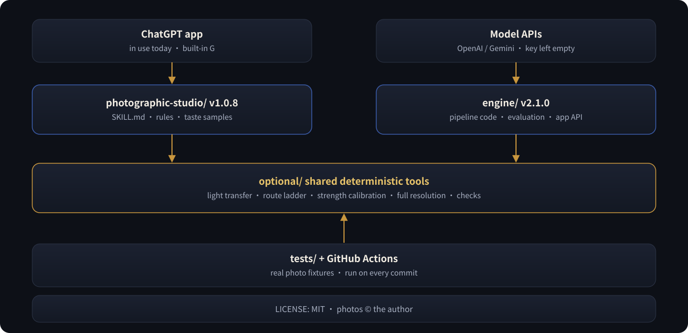

<p align="center">
  
</p>

<p align="center">
  <b>English</b> ·
  <a href="README.zh-CN.md">简体中文</a> ·
  <a href="README.zh-TW.md">繁體中文</a>
</p>

<p align="center">
  
  
  
  
  
  
</p>

<p align="center">
  <b>Send a photo. Say one word: “fix” (or 「修」).</b><br>
  Like a seasoned retoucher, it first reads what your photo is about — then hands you back one finished image<br>
  that <b>clearly looks better, is still the moment you captured, has light that makes sense, and shows no trace of AI</b>.
</p>

---

## 🎯 What problem it solves

For people who **love taking photos but don't want to spend time on post-processing**.

- Doing it yourself (Lightroom and the like) takes skill and time for every photo.
- One-tap enhance buttons either change almost nothing, or over-process: plastic textures, fake HDR, invented light, details the camera never saw.

Photographic Studio sits in between: **one word, one finished photo**. It reads the photo first, then edits it so that it is clearly better, still the moment you captured (every pixel comes from your original), with light that obeys real physics, and no AI look. Architecture, street, landscape, night, interiors, still life and museum pieces — **not portraits**.

---

## 🎞️ Before &amp; after

> Left: original. Right: finished. All photos were taken by the author; every result here was picked and approved by the author.

<table>
  <tr>
    <td width="50%"><br><sub><b>Tower and reflection at night</b> · the night sky stays black; the tower, bridge and reflections glow clearer</sub></td>
    <td width="50%"><br><sub><b>Canal and clouds</b> · the sky gains colour and volume; trees emerge from the blacks</sub></td>
  </tr>
  <tr>
    <td><br><sub><b>Inlaid bronze ox lamp</b> · bronze, green patina and red inlay come apart; the black wall stays clean</sub></td>
    <td><br><sub><b>Cobalt-and-gold vase</b> · deeper cobalt, brighter gold — and not a lumen added to the dark showcase</sub></td>
  </tr>
  <tr>
    <td><br><sub><b>Clock tower framed by steel</b> · warm sunset against cool steel</sub></td>
    <td><br><sub><b>Willows over a lake</b> · restrained clarity, the quiet of a clear day</sub></td>
  </tr>
</table>

---

## 🔁 Input &amp; output

**In a chat (the skill)** — input: one photo and one word. Output: one finished photo, one line of story and style, and a label saying how it was made. Two real deliveries from the test runs:

```text
you:  (photo of a vine under a skylight)  修
it:   (finished photo)
      Story: a dead vine casts crossing shadows under a geometric skylight | Style: quiet modern interior, vine shadows in dialogue with the architecture
      original pixels + G light & colour → N refine
```

```text
you:  (photo of red maples against a grey garden wall)  修
it:   (finished photo)
      Story: red maples and tile shadows on an old wall in clear weather | Style: crisp garden architecture, grey brick behind red leaves
      N direct          ← the image model darkened the sky twice, both drafts were rejected, so only deterministic grading was used
```

**On the command line (the engine, prototype)** — input: a photo file. Output: a folder with `final.png` (or `final_full.jpg` for photos larger than the working size), `receipt.json` with every step, its time and the estimated model cost, plus the intermediate files. A real run, replaying a recorded museum photo:

```text
$ python -m studio_engine.cli run original.jpeg out/
{ "status": "done", "final": "out/final.png", "route": "museum_strength", "seconds": 66.7, "cost_usd": 0.0 }
steps: measure 1.3 s · brief · G · finish 26.0 s · settle 33.4 s · n_trim 0.3 s
```

(`cost_usd` is 0 here because the replay provider makes no paid call; with a real model API the receipt shows the estimate.)

---

## 🎬 How it edits a photo

<p align="center">
  
</p>

**1 · Read the photo**　First it answers *what is this photo about?* — story, mood, subject, style. Then: where the light comes from, how the colours work, how space is layered.

**2 · Write a director's brief**　Six lines of post-production intent, for example:

```text
Story | style : a dark showcase; cobalt glaze and gold catch the exhibit light | low-key museum still life
Subject       : the cobalt vase — amplify the lit volume and the gold relief; keep the background dark
Tone          : keep the blacks, ease the highlights, open the subject's midtones, more local contrast
Colour        : cobalt and warm gold lead; richer glaze and gilding; calm the plinth's colour cast
Do not touch  : shape, patterns, finial, label, the real reflections in the glass
Composition   : keep — the line drawing, the vase and the reflection tell the exhibition together
```

**3 · Borrow only AI's light &amp; colour**　The host's image model makes a version, but **only its light and colour are taken**. Every pixel of the result still comes from your original — the text, the people, the textures are the ones you actually captured.

**4 · Refine and check**　Deterministic grading tools finish the brief, then the image has to pass two gates:

- **Physics** — brightening only lands where light already falls; no invented halos around an exhibit, no real highlights or glaze sheen wiped away; tonal order, sky gradients and reflections all have to make sense.
- **Strength** — visibly better, never overdone; museum pieces are judged on the subject itself.

Not good enough? It quietly retries a safer step on its own until a result passes — **it never stops to ask you**.

**5 · One photo**　You get exactly one image, with a single line: `story | style`.

---

## 🧭 Four things it never compromises on

| | |
|:--:|---|
| 🔆 | **Expression first** — an edit nobody can see counts as a failure. |
| 📷 | **Still your moment** — same scene, same time, same viewpoint. |
| 🕯️ | **Light that makes sense** — amplify the light already in the photo; never paint light that couldn't exist. |
| 🍃 | **No AI look** — nothing waxy or plastic, no fake detail, no fake HDR. |

---

## 🚀 Installation

**Two separate ways to use it — pick one:**

| | Skill (`photographic-studio/` folder) | Engine (`engine/` folder, whole repository) |
|---|---|---|
| Who it is for | anyone with an AI agent (tested: ChatGPT app) | developers; the future app's back end |
| API key | **not needed** — it uses the agent's own image tool and Python | **needed** — your own OpenAI or Gemini key; you pay for the usage |
| How you use it | send a photo and say `fix` | command line or HTTP API on your own computer/server |
| Status | in daily use | prototype; not yet run against a live API |

The skill package has no place for an API key, and it does not contain the engine.


**Install as an Agent Skill**: install the whole [`photographic-studio/`](photographic-studio) folder into a host that supports `SKILL.md` (tested in the ChatGPT app; other hosts should work but are untested), then:

```text
(send a photo) fix
```

**Hosts without skill install**: zip the folder, attach it, and say:

```text
Process this photo with the attached Photographic Studio
```

**The engine (prototype, Python 3.11+)**:

```bash
pip install -r engine/requirements.txt
cp engine/config.example.toml engine/config.toml     # set the model names; this file is git-ignored
export OPENAI_API_KEY=...                            # or GEMINI_API_KEY=... (or put the key in config.toml)
cd engine && python -m studio_engine.cli selftest    # shows what is configured; --live makes one small real call
```

The engine has not yet been run against a live model API: no key has been configured so far.

---

## 🕹️ Usage

### In a chat (the skill)

| You say | It does |
|---|---|
| `fix` · `修` | read → brief → edit → check → one finished photo |
| `fine-tune` · `精修` | explores several directions and keeps the best (slower) |
| `too warm` · `a bit clearer` | rewrites the brief and redoes it; notes the taste for this conversation |
| `show receipt` · `看回执` | brief, prompt, parameters, check results |
| `show flag log` · `看标记表` | a running log of flags across photos |

### On the command line (the engine)

| Command | Does |
|---|---|
| `python -m studio_engine.cli run PHOTO OUT_DIR` | one photo → `OUT_DIR/final.png` + `receipt.json` |
| `python -m studio_engine.eval SET_DIR OUT_DIR --runs=2` | every photo in a folder, N times each → comparison sheets + `summary.md` (finish rate, time, cost, run-to-run difference, runs over 2 minutes) |
| `uvicorn service.app:app` | HTTP API for the future app: upload, poll, download, delete (prototype: no accounts or payments) |

### Capability tiers

It looks at what the host can do first, then decides how to work:

| Tier | Host can… | How the photo is made |
|:--:|---|---|
| **T1** | edit images with a model **and** run Python | original pixels + AI light &amp; colour → refine |
| **T2** | run Python only | deterministic grading |
| **T3** | edit images with a model only | the model's edit, honestly labelled |
| **T4** | neither | a reading of the photo and editing advice |

---

## 🏗️ Architecture

<p align="center">
  
</p>

Two ways in, **one set of rules**. Both call the same deterministic tools in `photographic-studio/optional/`, so every improvement reaches both, and the tests cover both.

| | ChatGPT skill (`photographic-studio/`) | Engine (`engine/`) |
|---|---|---|
| Status | in daily use | prototype, waiting for an API key |
| Who runs the steps | the agent, reading `SKILL.md` | code |
| G (light & colour model) | the host's built-in image tool | an image-editing API (OpenAI / Gemini, set in `config.toml`) |
| Good for | editing photos today | batch evaluation, full-resolution output, the future app's back end |
| Target time | — | ≤ 2 minutes per photo |

API keys are left empty on purpose: set `OPENAI_API_KEY` / `GEMINI_API_KEY` or fill `engine/config.toml` (git-ignored). Details in [`engine/README.md`](engine/README.md).

## 🗂️ Repository layout

```text
photographic-studio/          ← the skill itself (install this folder)
├── SKILL.md                  ← entry point and instructions
├── references/               ← principles, reading & prescriptions, genres, brief, physics, strength, delivery…
│   └── genres/               ← architecture · street · landscape · night · interior · still life & museum
├── optional/                 ← tools (numpy · Pillow · OpenCV)
│   ├── finish.py             ← one-step edit with an automatic retry ladder
│   ├── look_transfer.py      ← original pixels + AI light & colour
│   ├── grade.py              ← grading by the director's brief
│   ├── settle.py             ← strength calibration in one call
│   ├── full_res.py           ← carries an edit back to full resolution
│   ├── physics_check.py      ← natural-light physics check
│   └── intensity_check.py    ← strength check
├── assets/taste/             ← taste references: before/after pairs approved by the author
├── CHANGELOG.md
└── SHA256SUMS.txt
engine/                       ← the pipeline as code (prototype)
├── studio_engine/            ← pipeline · model providers · evaluation · CLI
├── service/app.py            ← HTTP API for the future app
└── config.example.toml       ← models and keys (copy to config.toml)
tests/                        ← tests + real photo fixtures (GitHub Actions on every commit)
docs/images/                  ← illustrations for this page
README.md · README.zh-CN.md · README.zh-TW.md
LICENSE                       ← MIT
```

> The skill's own instructions and references are written in Chinese; any capable agent can follow them.

---

## 📜 License

The skill — instructions, references and tools — is licensed under the [MIT License](LICENSE) (since 2026-11-14; earlier versions were AGPL-3.0).
The example and test photographs (`photographic-studio/assets/`, `tests/fixtures/`, `docs/images/`) are © the author and are **not** covered by this license; please do not reuse them without permission.

---

<p align="center">
  <sub>Photographic Studio v1.0.8 · made for non-portrait photography · built together with Claude · code &amp; docs MIT · photos © the author</sub>
</p>
