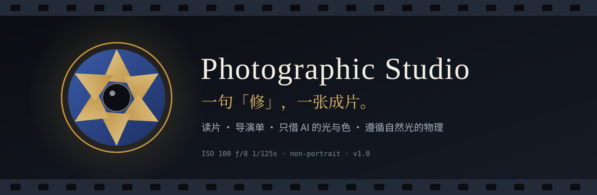
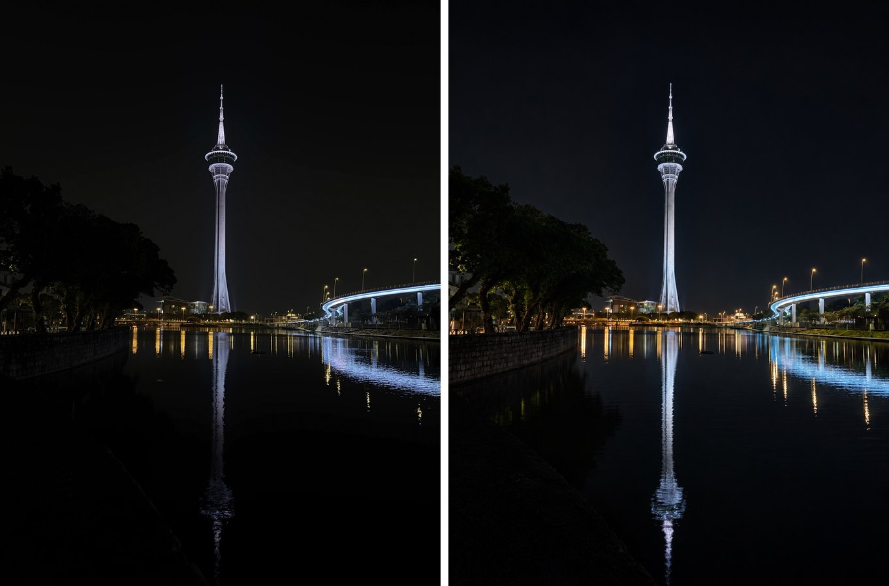
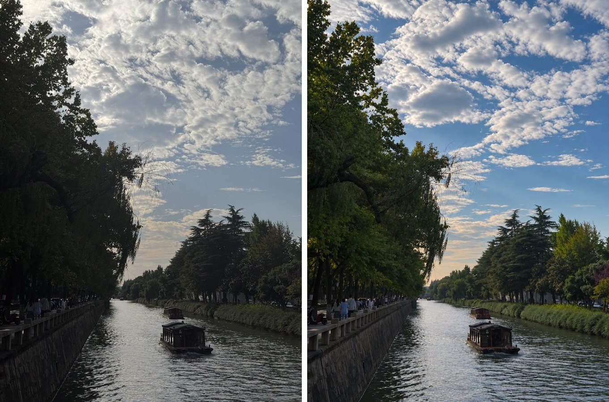
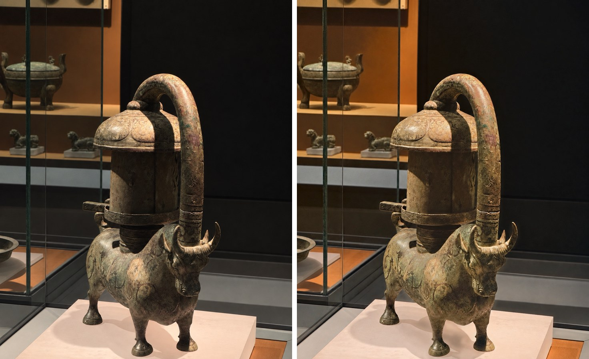
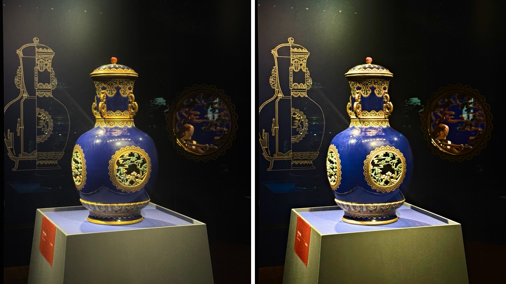
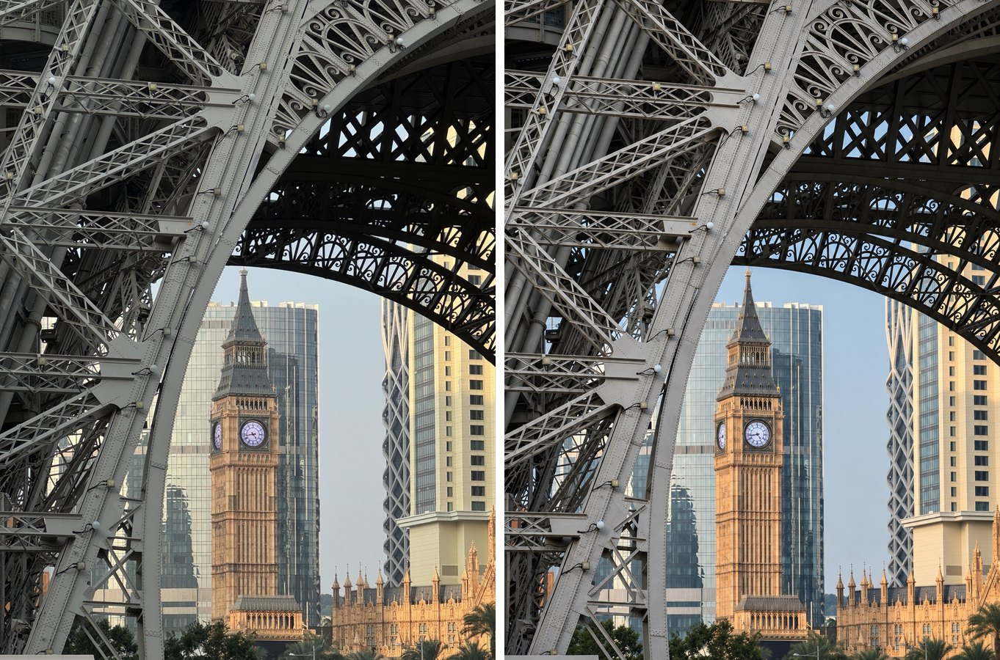
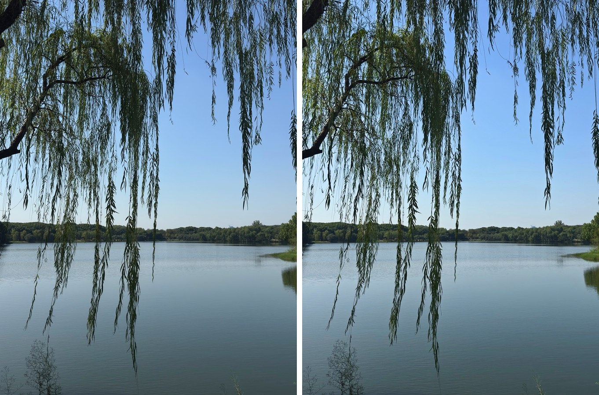
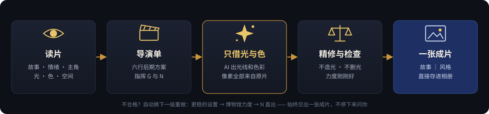
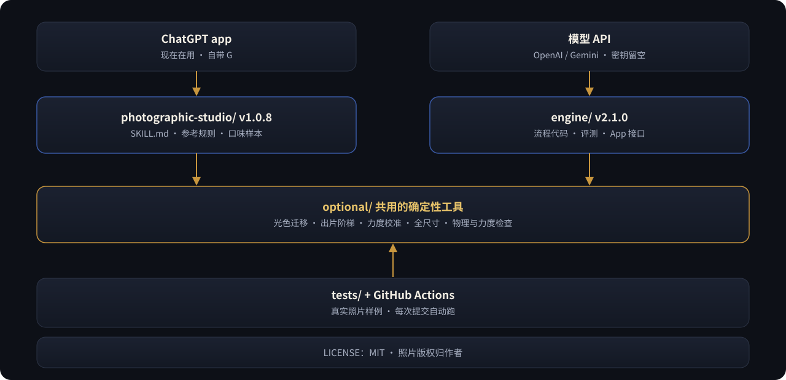

<p align="center">
  
</p>

<p align="center">
  <a href="README.md">English</a> ·
  <b>简体中文</b> ·
  <a href="README.zh-TW.md">繁體中文</a>
</p>

<p align="center">
  
  
  
  
  
  
</p>

<p align="center">
  <b>发一张照片，说一个字：「修」。</b><br>
  它会像一位后期摄影师那样先读懂这张照片，再交给你一张——<br>
  <b>看得出提升、仍然是你拍的那一刻、光线讲得通、看不出 AI 痕迹</b>——的成片。
</p>

---

## 🎯 解决什么问题

给**喜欢拍照、但不想花时间修图**的人用。

- 自己用 Lightroom 一类的软件修，每张都要技术和时间。
- 一键增强要么几乎没变化，要么处理过度：塑料感、假 HDR、凭空加光、补出相机没拍到的细节。

Photographic Studio 介于两者之间：**一句话，一张成片**。它先读懂照片，再修到明显更好，同时仍是你拍下的那一刻（每个像素都来自原片）、光线符合真实物理、看不出 AI 痕迹。适用于建筑、街景、风光、夜景、室内、静物与展品——**不处理人像**。

---

## 🎞️ 前后对比

> 左为原片，右为成片。照片都是作者自己拍的，成片经作者亲自挑选认可。

<table>
  <tr>
    <td width="50%"><br><sub><b>夜色中的塔与倒影</b> · 保住夜空的黑，让塔、桥和倒影的灯更清楚</sub></td>
    <td width="50%"><br><sub><b>运河与云</b> · 天空有了颜色和体积，树从死黑里透出层次</sub></td>
  </tr>
  <tr>
    <td><br><sub><b>错金银铜牛灯</b> · 铜色、绿锈、赭红分明，黑墙依旧干净</sub></td>
    <td><br><sub><b>蓝釉金彩瓶</b> · 钴蓝更浓、金饰更亮，展柜的暗一点不提</sub></td>
  </tr>
  <tr>
    <td><br><sub><b>铁塔框景里的钟楼</b> · 夕阳的暖与钢架的冷拉开</sub></td>
    <td><br><sub><b>垂柳与湖</b> · 克制的清透，晴日里的安静</sub></td>
  </tr>
</table>

---

## 🔁 输入与输出示例

**在对话里（skill）**——输入：一张照片加一个字。输出：一张成片、一行故事与风格、一个说明怎么做出来的标签。下面是测试中的两次真实交付：

```text
你：  （天窗下枯藤的照片）修
它：  （成片）
      故事：枯藤在几何天窗下投出交错影子｜风格：静谧现代室内，藤影与建筑几何对话
      原片像素 + G 光色 → N 精修
```

```text
你：  （灰墙前红枫的照片）修
它：  （成片）
      故事：晴日古墙前红枫与瓦影相映｜风格：清透园林建筑，灰砖衬红叶
      N 直出          ← 图像模型两次都把天空压暗，被检查拦下，只用确定性调色出片
```

**在命令行里（引擎，原型）**——输入：一个照片文件。输出：一个文件夹，里面有 `final.png`（照片大于工作尺寸时为 `final_full.jpg`）、记录每一步耗时和估算模型费用的 `receipt.json`，以及中间文件。下面是一次真实运行（回放一张已记录的博物馆照片）：

```text
$ python -m studio_engine.cli run original.jpeg out/
{ "status": "done", "final": "out/final.png", "route": "museum_strength", "seconds": 66.7, "cost_usd": 0.0 }
steps: measure 1.3 s · brief · G · finish 26.0 s · settle 33.4 s · n_trim 0.3 s
```

（这里 `cost_usd` 为 0，是因为回放模式不发出付费调用；接上真实模型 API 后，回执里会显示估算费用。）

---

## 🎬 它怎么修一张照片

<p align="center">
  
</p>

**1 · 读片**　先回答“这张照片在讲什么”：故事、情绪、主角、风格方向；再看光从哪来、颜色怎么搭、空间怎么分层。

**2 · 导演单**　把判断写成六行后期方案，例如：

```text
故事｜风格：暗展柜中，蓝釉与金饰承接展灯｜低调博物馆静物，深蓝与暖金分明
主角：中央蓝釉瓶；怎么突出：放大已有受光面的体积与金饰反差，背景保持深暗
影调：黑场保留，高光轻压，主体中间调展开，局部反差增加
色彩：钴蓝与暖金为主，加强釉色与金饰，收敛台座偏色
不能动：瓶形、纹样、顶珠、展签、玻璃里的真实反光
构图：保持——线图、瓶子与右侧映像共同交代展陈
```

**3 · 只借 AI 的光与色**　让宿主的图像模型出一版，但**只拿走它的光线和色彩**，成片的每一个像素仍然来自原片——文字、人物、纹理都是你拍到的那些。

**4 · 精修与检查**　确定性调色工具按导演单补齐，再过两道关：

- **物理关**：加亮只落在原本有光的地方；不给展品凭空加光圈，也不把真实的光斑、釉光抹掉；明暗次序、天空渐变、倒影都要讲得通。
- **力度关**：看得出提升，又不过头；博物馆展品按主角来判断。

不合格？它会自己换一级更稳的做法重来，直到交出一张合格的成片——**不停下来问你**。

**5 · 一张成片**　只交一张图，配一行 `故事｜风格`。

---

## 🧭 它坚持的四件事

| | |
|:--:|---|
| 🔆 | **表现力第一**——“改了等于没改”算失败。 |
| 📷 | **还是你拍的那一刻**——同一场景、同一时刻、同一视角。 |
| 🕯️ | **光要讲得通**——放大照片里本来就有的光，不画现实中不存在的光。 |
| 🍃 | **看不出 AI**——没有磨皮感、塑料感、假细节、假 HDR。 |

---

## 🚀 安装

**两种独立的用法，二选一：**

| | Skill（`photographic-studio/` 目录） | 引擎（`engine/` 目录，需要整个仓库） |
|---|---|---|
| 适合谁 | 有 AI agent 的任何人（实测：ChatGPT app） | 开发者；未来 App 的后端 |
| API 密钥 | **不需要**——用 agent 自带的图像工具和 Python | **需要**——你自己的 OpenAI 或 Gemini 密钥，费用由你支付 |
| 怎么用 | 发一张照片，说「修」 | 在自己的电脑或服务器上用命令行或 HTTP 接口 |
| 状态 | 日常在用 | 原型；还没有接真实 API 跑过 |

Skill 包里没有填 API 密钥的地方，也不包含引擎。


**作为 Agent Skill 安装**：把 [`photographic-studio/`](photographic-studio) 整个目录安装到支持 `SKILL.md` 的宿主（实测过的是 ChatGPT app；其他宿主应可使用，但尚未实测），然后：

```text
（发一张照片）修
```

**不能安装的宿主**：把目录打包成 zip，作为附件发过去，说一句：

```text
按附件里的 Photographic Studio 处理这张照片
```

**引擎（原型，Python 3.11+）**：

```bash
pip install -r engine/requirements.txt
cp engine/config.example.toml engine/config.toml     # 填模型名；这个文件不会上传到 GitHub
export OPENAI_API_KEY=...                            # 或 GEMINI_API_KEY=...（也可以填进 config.toml）
cd engine && python -m studio_engine.cli selftest    # 显示配置情况；加 --live 发一次很小的真实调用
```

引擎目前还没有接真实的模型 API 跑过：至今还没有配置密钥。

---

## 🕹️ 使用方法

### 在对话里（skill）

| 你说 | 它做 |
|---|---|
| `修` | 读片 → 导演单 → 出片 → 检查 → 交一张成片 |
| `精修` | 多出几个方向，比较后挑最好的一张（更慢） |
| `太暖了` · `再通透一点` | 按你的话改导演单重做；本次对话内记下这条口味 |
| `看回执` | 导演单、提示词、参数、检查结论 |
| `看标记表` | 每张照片的处理标记汇总 |

### 在命令行里（引擎）

| 命令 | 作用 |
|---|---|
| `python -m studio_engine.cli run 照片 输出目录` | 一张照片 → `输出目录/final.png` + `receipt.json` |
| `python -m studio_engine.eval 照片目录 输出目录 --runs=2` | 目录里每张照片各跑 N 次 → 对比图 + `summary.md`（完成率、耗时、费用、两次之间的差别、超过 2 分钟的次数） |
| `uvicorn service.app:app` | 给未来 App 用的 HTTP 接口：上传、查询、下载、删除（原型：还没有账号和支付） |

### 能力分级

它会先看宿主有什么工具，再决定怎么做：

| 级别 | 宿主能力 | 出片方式 |
|:--:|---|---|
| **T1** | 有图像编辑模型，也能运行 Python | 原片像素 + AI 光色 → 精修 |
| **T2** | 只能运行 Python | 确定性调色直出 |
| **T3** | 只有图像编辑模型 | 直接用模型的结果，并如实说明 |
| **T4** | 都没有 | 给出读片与后期建议 |

---

## 🏗️ 架构

<p align="center">
  
</p>

两个入口，**同一套规则**。两边都调用 `photographic-studio/optional/` 里的同一套确定性工具，所以每次改进两边同时生效，测试也同时覆盖两边。

| | ChatGPT 版（`photographic-studio/`） | 引擎（`engine/`） |
|---|---|---|
| 状态 | 日常在用 | 原型，等 API 密钥 |
| 谁来执行步骤 | GPT 读 `SKILL.md` 自己执行 | 代码 |
| G（光色模型） | 宿主自带的图像工具 | 图像编辑 API（OpenAI / Gemini，在 `config.toml` 里设置） |
| 适合 | 现在修图 | 批量评测、全尺寸输出、未来 App 的后端 |
| 目标耗时 | — | 每张 ≤ 2 分钟 |

API 密钥特意留空：设置环境变量 `OPENAI_API_KEY` / `GEMINI_API_KEY`，或填进 `engine/config.toml`（不会上传到 GitHub）。详见 [`engine/README.md`](engine/README.md)。

## 🗂️ 仓库结构

```text
photographic-studio/          ← Skill 本体（安装这个目录）
├── SKILL.md                  ← 执行说明，入口
├── references/               ← 总则、读片与处方、六类题材、导演单、物理、力度、交付……
│   └── genres/               ← 建筑 · 街景 · 风光 · 夜景 · 室内 · 静物与展品
├── optional/                 ← 工具（numpy · Pillow · OpenCV）
│   ├── finish.py             ← 一步出片，含自动重做阶梯
│   ├── look_transfer.py      ← 原片像素 + AI 光色
│   ├── grade.py              ← 按导演单调色
│   ├── settle.py             ← 一次完成力度校准
│   ├── full_res.py           ← 把修图带回原图尺寸
│   ├── physics_check.py      ← 自然光物理检查
│   └── intensity_check.py    ← 力度检查
├── assets/taste/             ← 口味参照：作者认可的前后对比
├── CHANGELOG.md
└── SHA256SUMS.txt
engine/                       ← 流程写成代码（原型）
├── studio_engine/            ← 流程 · 模型接口 · 评测 · 命令行
├── service/app.py            ← 给未来 App 用的 HTTP 接口
└── config.example.toml       ← 模型和密钥（复制为 config.toml）
tests/                        ← 测试与真实照片样例（每次提交自动跑）
docs/images/                  ← 本页的插图
README.md · README.zh-CN.md · README.zh-TW.md
LICENSE                       ← MIT
```

---

## 📜 许可证

Skill 本身（执行说明、参考文件和工具）采用 [MIT 许可证](LICENSE) 授权（2026-11-14 起；此前的版本为 AGPL-3.0）。
示例与测试照片（`photographic-studio/assets/`、`tests/fixtures/`、`docs/images/`）版权归作者所有，**不在**此许可证范围内，未经许可请勿转载。

---

<p align="center">
  <sub>Photographic Studio v1.0.8 · 为非人像摄影而做 · 与 Claude 共同打造 · 代码与文档 MIT · 照片 © 作者本人</sub>
</p>
