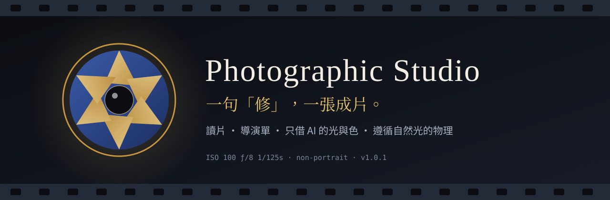
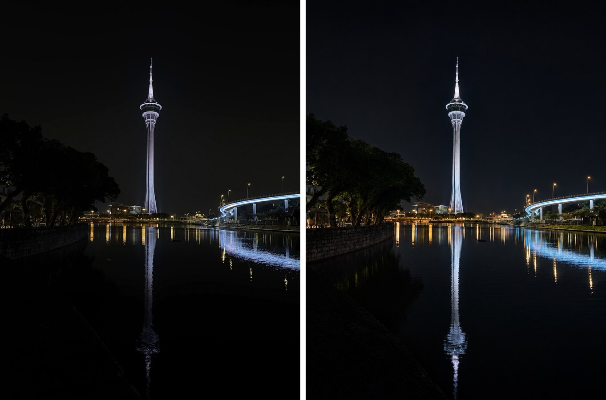
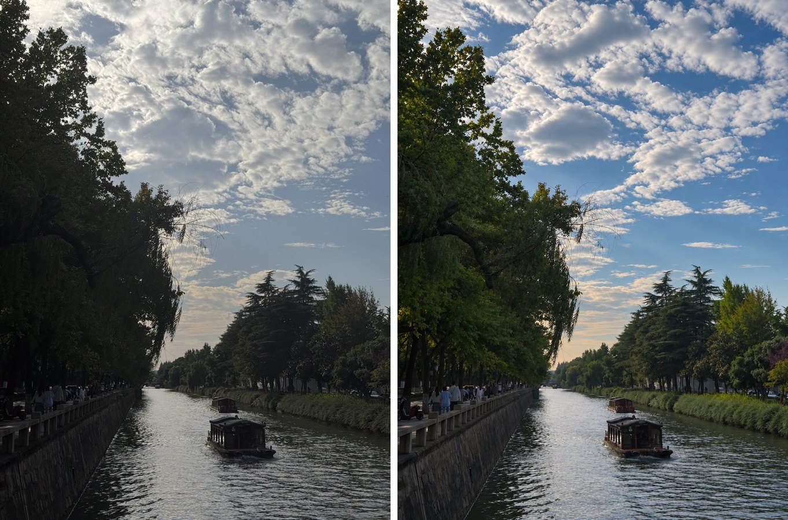
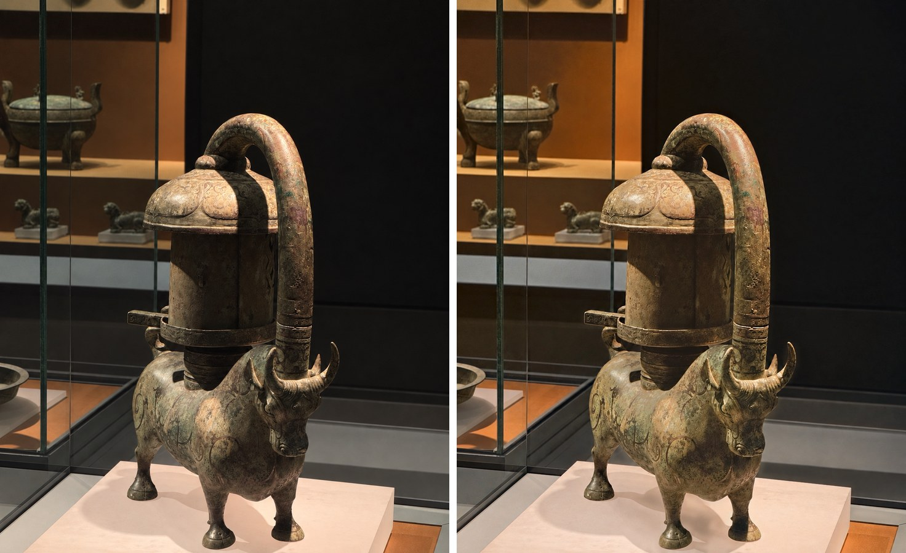
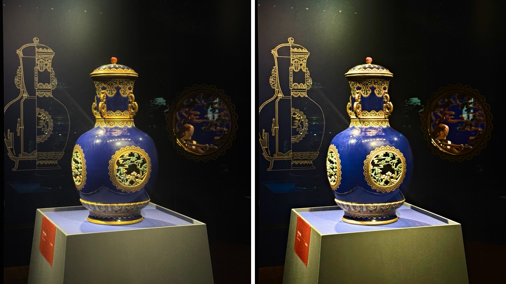
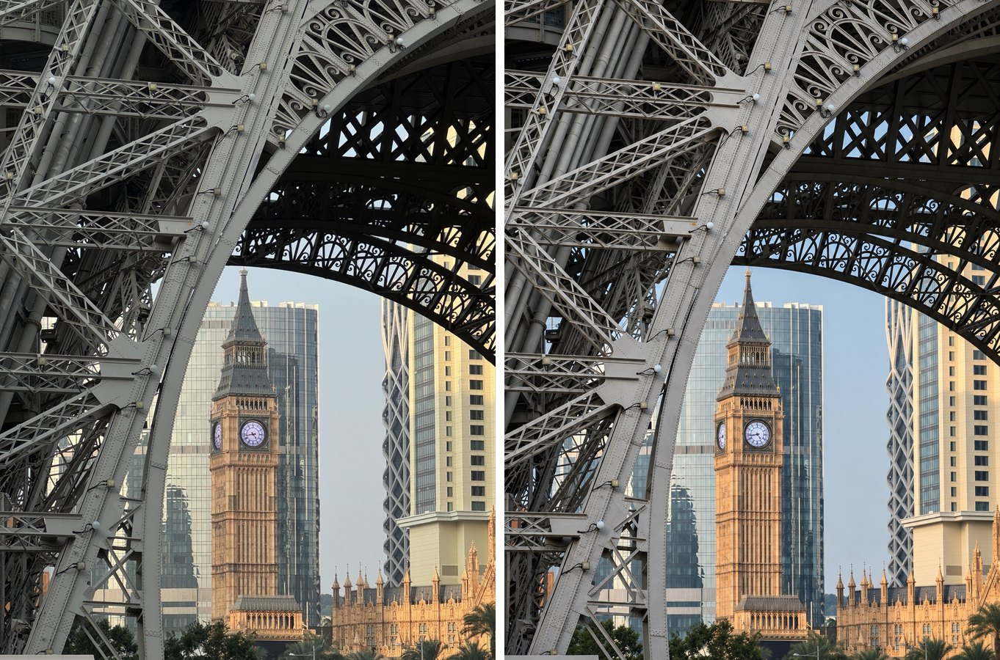
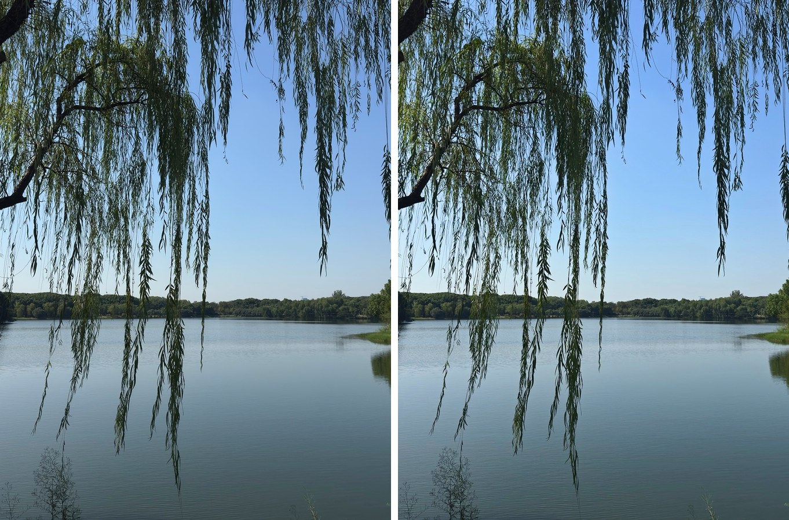
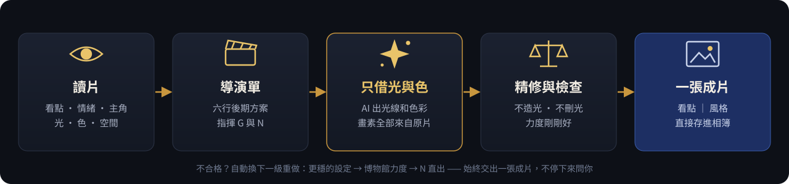

<p align="center">
  
</p>

<p align="center">
  <a href="README.md">English</a> ·
  <a href="README.zh-CN.md">简体中文</a> ·
  <b>繁體中文</b>
</p>

<p align="center">
  
  
  
  
  
</p>

<p align="center">
  <b>發一張照片，說一個字：「修」。</b><br>
  它會像一位後期攝影師那樣先讀懂這張照片，再交給你一張——<br>
  <b>看得出提升、仍然是你拍的那一刻、光線講得通、看不出 AI 痕跡</b>——的成片。
</p>

---

## 🎞️ 前後對比

> 左為原片，右為成片。照片都是作者自己拍的，成片經作者親自挑選認可。

<table>
  <tr>
    <td width="50%"><br><sub><b>夜色中的塔與倒影</b> · 保住夜空的黑，讓塔、橋和倒影的燈更清楚</sub></td>
    <td width="50%"><br><sub><b>運河與雲</b> · 天空有了顏色和體積，樹從死黑裡透出層次</sub></td>
  </tr>
  <tr>
    <td><br><sub><b>錯金銀銅牛燈</b> · 銅色、綠鏽、赭紅分明，黑牆依舊乾淨</sub></td>
    <td><br><sub><b>藍釉金彩瓶</b> · 鈷藍更濃、金飾更亮，展櫃的暗一點不提</sub></td>
  </tr>
  <tr>
    <td><br><sub><b>鐵塔框景裡的鐘樓</b> · 夕陽的暖與鋼架的冷拉開</sub></td>
    <td><br><sub><b>垂柳與湖</b> · 剋制的清透，晴日裡的安靜</sub></td>
  </tr>
</table>

---

## 🎬 它怎麼修一張照片

<p align="center">
  
</p>

**1 · 讀片**　先回答“這張照片在講什麼”：故事、情緒、主角、風格方向；再看光從哪來、顏色怎麼搭、空間怎麼分層。

**2 · 導演單**　把判斷寫成六行後期方案，例如：

```text
故事｜風格：暗展櫃中，藍釉與金飾承接展燈｜低調博物館靜物，深藍與暖金分明
主角：中央藍釉瓶；怎麼突出：放大已有受光面的體積與金飾反差，背景保持深暗
影調：黑場保留，高光輕壓，主體中間調展開，局部反差增加
色彩：鈷藍與暖金為主，加強釉色與金飾，收斂臺座偏色
不能動：瓶形、紋樣、頂珠、展簽、玻璃裡的真實反光
構圖：保持——線圖、瓶子與右側映像共同交代展陳
```

**3 · 只借 AI 的光與色**　讓宿主的影像模型出一版，但**只拿走它的光線和色彩**，成片的每一個畫素仍然來自原片——文字、人物、紋理都是你拍到的那些。

**4 · 精修與檢查**　確定性調色工具按導演單補齊，再過兩道關：

- **物理關**：加亮只落在原本有光的地方；不給展品憑空加光圈，也不把真實的光斑、釉光抹掉；明暗次序、天空漸變、倒影都要講得通。
- **力度關**：看得出提升，又不過頭；博物館展品按主角來判斷。

不合格？它會自己換一級更穩的做法重來，直到交出一張合格的成片——**不停下來問你**。

**5 · 一張成片**　只交一張圖，配一行 `故事｜風格`。

---

## 🧭 它堅持的四件事

| | |
|:--:|---|
| 🔆 | **表現力第一**——“改了等於沒改”算失敗。 |
| 📷 | **還是你拍的那一刻**——同一場景、同一時刻、同一視角。 |
| 🕯️ | **光要講得通**——放大照片裡本來就有的光，不畫現實中不存在的光。 |
| 🍃 | **看不出 AI**——沒有磨皮感、塑膠感、假細節、假 HDR。 |

---

## 🚀 開始使用

**作為 Agent Skill 安裝**：把 [`photographic-studio/`](photographic-studio) 整個目錄安裝到支援 `SKILL.md` 的宿主，然後：

```text
（發一張照片）修
```

**不能安裝的宿主**：把目錄打包成 zip，作為附件發過去，說一句：

```text
按附件裡的 Photographic Studio 處理這張照片
```

### 口令

| 你說 | 它做 |
|---|---|
| `修` | 讀片 → 導演單 → 出片 → 檢查 → 交一張成片 |
| `精修` | 多出幾個方向，比較後挑最好的一張（更慢） |
| `太暖了` · `再通透一點` | 按你的話改導演單重做，並記住這條口味 |
| `看回執` | 導演單、提示詞、參數、檢查結論 |
| `看標記表` | 每張照片的處理標記彙總 |

### 能力分級

它會先看宿主有什麼工具，再決定怎麼做：

| 級別 | 宿主能力 | 出片方式 |
|:--:|---|---|
| **T1** | 有影像編輯模型，也能執行 Python | 原片畫素 + AI 光色 → 精修 |
| **T2** | 只能執行 Python | 確定性調色直出 |
| **T3** | 只有影像編輯模型 | 直接用模型的結果，並如實說明 |
| **T4** | 都沒有 | 給出讀片與後期建議 |

---

## 🗂️ 倉庫結構

```text
photographic-studio/          ← Skill 本體（安裝這個目錄）
├── SKILL.md                  ← 執行說明，入口
├── references/               ← 總則、讀片與處方、六類題材、導演單、物理、力度、交付……
│   └── genres/               ← 建築 · 街景 · 風光 · 夜景 · 室內 · 靜物與展品
├── optional/                 ← 工具（numpy · Pillow · OpenCV）
│   ├── finish.py             ← 一步出片，含自動重做階梯
│   ├── look_transfer.py      ← 原片畫素 + AI 光色
│   ├── grade.py              ← 按導演單調色
│   ├── physics_check.py      ← 自然光物理檢查
│   └── intensity_check.py    ← 力度檢查
├── assets/taste/             ← 口味參照：作者認可的前後對比
├── CHANGELOG.md
└── SHA256SUMS.txt
docs/images/                  ← 本頁的插圖
README.md · README.zh-CN.md · README.zh-TW.md
LICENSE                       ← AGPL-3.0
```

---

## 📜 授權條款

Skill 本身（執行說明、參考檔案和工具）採用 [GNU Affero General Public License v3.0](LICENSE) 授權。
`photographic-studio/assets/taste/` 中的示例照片版權歸作者所有，**不在**此授權範圍內，未經許可請勿轉載。

---

<p align="center">
  <sub>Photographic Studio v1.0.2 · 為非人像攝影而做 · 與 Claude 共同打造 · 程式碼與文件 AGPL-3.0 · 照片 © 作者本人</sub>
</p>
